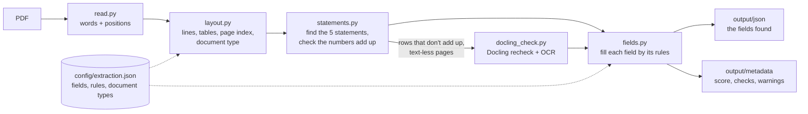

# PDF Extractor

Turns company PDFs (10-K, 10-Q, press release, 8-K, proxy statement, Form 10, call transcript, slides) into JSON with
only the fields the team listed for that document type, plus a metadata file saying what was found, what was not, and
how far each number could be checked. No language model is used.

## Architecture



`extract.py` runs many PDFs in parallel worker processes: a crashed or stuck worker only fails its own PDF.
`pdf_pipeline.process(path)` does the same for one PDF from code and returns `(fields, metadata)`.

| File | Does |
|---|---|
| `read.py` | Reads every word with its position, size and boldness (PyMuPDF) |
| `layout.py` | Words to lines, rows and tables; page index; recognises the document type |
| `statements.py` | Finds income / balance sheet / cash flow / equity statements; arithmetic checks (sums, balance, cash roll-forward, EPS) |
| `docling_check.py` | Docling re-reads only the pages we misread, and OCRs pages without text |
| `fields.py` | Fills each required field by its rules; builds the metadata |
| `pipeline.py` | Runs the steps for one PDF |

## Run

```bash
python -m venv .venv
.venv/Scripts/python -m pip install -r requirements.txt     # macOS/Linux: .venv/bin/python
.venv/Scripts/python extract.py                             # every PDF in input/ and its sub-folders
.venv/Scripts/python extract.py input/NVDA_10K_FY2026.pdf   # one file
.venv/Scripts/python extract.py --workers 4                 # 4 PDFs at a time
.venv/Scripts/python extract.py --fast                      # skip the Docling recheck
.venv/Scripts/python extract.py --resume                    # skip PDFs already done with this version and config
```

`--timeout` (default 1200 s) stops a PDF that takes too long. The first run downloads Docling's models (about 1 GB; about
1.2 GB of memory per worker). Speed on a 4-core laptop: 1-2 s per filing with `--fast`; the 13 test PDFs take about 3
minutes with the Docling recheck.

## Config: `config/extraction.json` (edit by hand)

| Section | Is |
|---|---|
| `fields` | The fields each source document needs: `10-K`, `10-Q`, `press release` ... |
| `rules` | How each field is found, by field name: statement rows, Item, note, section, tables or sentences; tried in order, first hit wins |
| `document_types` | How each type is recognised (the SEC cover sentence, else a name pattern) and which `fields` lists it uses |
| `page_scopes`, `skip_pages`, `applies_if` | Page ranges some rules are limited to; pages sentence rules must skip; fields that only apply to one company |

A field under `fields` needs a rule under `rules` with the same name, otherwise it is reported as not found. The file is
checked before any PDF is read; a typo stops the run with a message. Everything in the file is explained in its `about`.

## Output

`output/json/<name>.json`: `document` (file, type, pages, company, period end) and `fields`, each with its `content`:
statement rows (values per period, page, unit, `check`), section text with pages, tables, or sentences with pages.

`output/metadata/<name>.json`: `score` (found / listed) and `score_applicable` (leaving out fields that cannot be in this
document), `found`, `not_found`, `not_applicable` (with reasons), `notes`, `statement_rows` (verified / confirmed /
unverified / conflict), plus version, config and file hashes, and `processing` (seconds, checks, Docling pages, warnings).
A PDF that cannot be used has a `status` instead of a score: `skipped: ...` or `failed: ...` (password-protected, empty,
not a PDF, damaged, blank, timed out, crashed).

A statement row's `check`: `verified` (an arithmetic check passes), `confirmed` (Docling read the same numbers),
`unverified`, or `conflict` (Docling read different numbers, shown in `docling_values`; ours are never overwritten).

## Limits

- Only what the document prints is used; nothing is calculated into the output.
- Not found also covers things a document does not contain, and things that need other documents (other quarters, guidance).
- Sentence-based fields are keyword rules and can include a weakly related sentence.
- Scanned pages are read with OCR, but headings and tables on them are not used, so a mostly scanned filing scores close to 0
  (its metadata says so). A damaged file is flagged, not repaired.
- Press release numbers are table rows as printed and have no arithmetic check. Only one press release has been tested; the
  proxy, Form 10, transcript and slides rules have not been run on real documents yet.
- Two-column layouts and sideways text are not reconstructed reliably.

## License

MIT, see [LICENSE](LICENSE). PyMuPDF (the PDF reader) is AGPL-3.0, so a deployment that uses it must meet AGPL terms; Docling is MIT.
